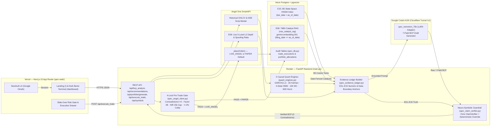

# Q-ARC: Neuro-Symbolic Behavioral Counterparty Profiling & State-Space Risk Architecture

Q-ARC is an institutional-grade, causal neuro-symbolic equity intelligence and execution platform for the National Stock Exchange of India (NSE). It separates probabilistic narrative generation (fine-tuned Nemotron-70B LoRA) from deterministic state-space econometrics and hard symbolic verification so ungrounded LLM priors cannot trigger capital-destroying trades during hostile market regimes.

- **Frontend Terminal (Vercel / Next.js 15):** https://qarc-platform.vercel.app
- **Backend API (Render / FastAPI):** https://qarc-platform.onrender.com

---

## 1. System Architecture



---

## 2. Core Quantitative & Neuro-Symbolic Components

### 2.1 Five Causal Quantitative Engines + Factor 4B

| Component | Module | Mathematical Formulation & Role |
| :--- | :--- | :--- |
| **GARCH(1,1) MLE** | `quant_engines.py` (`GARCHForecaster`) | Fits $\sigma_t^2 = \omega + \alpha \epsilon_{t-1}^2 + \beta \sigma_{t-1}^2$ via SciPy `L-BFGS-B` ($\alpha + \beta < 0.9999$) to compute annualized conditional volatility, long-run hazard ratio, and `SHOCK_VOLATILITY` alerts ($|r_T| \ge 3\sigma$). |
| **2D Kalman Filter** | `quant_engines.py` (`KalmanTrendFilter`) | Tracks latent state $x_t = [\text{price\_level}_t, \text{trend\_velocity}_t]^T$ with constant-velocity transition $F = [[1, 1], [0, 1]]$ to separate multi-day institutional drift from bid-ask microstructure noise. |
| **4-State Gaussian HMM** | `quant_engines.py` (`HMMRegimeClassifier`) | Fits diagonal-covariance `GaussianHMM` on causal $[\ln(C_t/C_{t-1}), \ln(V_t / \overline{V}_{20,t})]$ across `[0 .. T-2]`, scores bar $T$ via one-step forward prediction, applies temperature calibration ($T = 1.35$) and Laplace smoothing ($\alpha = 0.05$) across `Accumulation`, `Markup`, `Distribution`, and `Markdown`, and reports Shannon entropy. |
| **10,000-Path Monte Carlo** | `quant_engines.py` (`MonteCarloRiskEngine`) | Simulates 10,000 10-day paths using GARCH volatility, HMM regime drift, and variance-normalized Student-$t$ ($\nu = 5$) heavy-tail innovations to compute $\text{VaR}_{95\%}$, $\text{CVaR}_{95\%}$, barrier probabilities, and a binding 3-factor position cap ($\min$ of Stop-Risk Budget, Target Volatility, and CVaR Stress). |
| **60D Rolling Hurst** | `qarc_walk_forward_backtest.py` (`compute_rolling_hurst`) | Regresses $\log \tau(L)$ against $\log L$ across lags $L \in \{2, 4, 8, 16\}$ over the trailing 60 bars ($H \in [0.1, 0.9]$) to route between mean-reversion and persistent trend regimes. |
| **Factor 4B Exhaustion Churn** | `discover_factors.py`, `qarc_claim_verifier.py` | Empirically identified trap where disclosed NSE Bulk/Block Deal activity coincides with `Daily Return > +1.0%` and `Delivery % < 40.0%`, producing `-0.81%` mean T+5 return (`-1.45%` alpha vs. baseline, $t = -3.75$, **$p = 0.0002$** across 384 occurrences). Prohibits `BUY` / `Institutional Accumulation` claims. |

### 2.2 Zero-Lookahead Guarantees

- **Chronological SFT Splits (`validate_and_split.py`):** Strict temporal partitioning across `data/train.csv` (9,189 rows), `data/val.csv` (1,218 rows), and `data/test.csv` (1,276 rows) with zero cross-date contamination.
- **Out-of-Sample HMM Filtering:** Parameters are fitted strictly on `[0 .. T-2]`; bar $T$ is evaluated solely through the one-step forward transition prior and emission likelihood.
- **Date-Fenced Vector Retrieval:** `E15` `pgvector` HNSW queries enforce `bar_date < as_of_date`, and `E08` Catalyst RAG queries enforce `filing_date <= as_of_date`.
- **Corporate-Action Backward Split Adjustment (`adjust_corporate_actions`):** Detects unadjusted NSE splits/bonuses/demergers (overnight drops $> 35\%$, exceeding daily circuit limits), snaps near-integer split ratios, and backward-adjusts prior OHLC and volume (eliminating false volatility spikes such as the `KOTAKBANK` 1:5 split on `2026-01-14`).

### 2.3 E01–E15 Evidence Ledger, `<5ms` ClaimVerifier & 4-Lock Pre-Trade Gate

1. **Evidence Ledger (`E01–E15`):** `qarc_evidence_ledger.py` compiles immutable numeric facts and explicit data-boundary limitations (`E01` Return, `E02` VWAP deviation, `E03` Delivery %, `E04` Volume Z-score, `E05` Amihud/ATR, `E06` HMM Phase, `E07` RSI(14), `E08` Exchange Filings >0.5% & Date-Fenced RAG, `E09` Live Angel One 5-Level L2 Depth or explicit unavailability, `E10–E13` GARCH/Kalman/HMM/MC anchors, `E14` Causal 5D Forecast, `E15` `pgvector` Twins).
2. **Dynamic Regime Lock & `<5ms` ClaimVerifier Override:** Prior to LLM decoding, `qarc_pipeline.py` / `qarc_model_client.py` injects regime constraints derived from `E11` and `E12`. Post-decoding, `ClaimVerifier.verify()` audits all 7 Behavioral Counterparty Profile (BCP) fields against `E01–E15`. Whenever `dominant_intent` or `counter_strategy` triggers a `CONTRADICTION`, `apply_deterministic_fallback_override()` patches only the contradicted fields deterministically in `<5ms` without LLM retries (`max_retries=0`), reducing the raw Pass-1 contradiction rate from **20.0% to 0.0%**.
3. **4-Lock Pre-Trade Gate (`qarc_angel_client.py::validate_and_execute_order`):** Every order submitted to `POST /api/execute_trade` must clear four server-side gates before `PAPER` simulation (default) or `LIVE_ANGEL` SmartAPI routing:
   - **Lock 1:** `unresolved_contradictions == 0`
   - **Lock 2:** `Factor 4B` exhaustion churn inactive on `BUY` / `ACCUMULATE`
   - **Lock 3:** Order notional $\le$ INR `25,000.00` safety cap
   - **Lock 4:** Limit price within $\pm 2.0\%$ of live LTP collar

---

## 3. Empirical Benchmarks

### 3.1 Walk-Forward Out-of-Sample Backtest (`qarc_walk_forward_backtest.py`)

Evaluated causally (`warmup = 40` bars, 231 OOS bars per ticker across 8 NSE large-cap equities: `RELIANCE`, `TCS`, `INFY`, `HDFCBANK`, `ICICIBANK`, `KOTAKBANK`, `DRREDDY`, `SBIN`) with corporate-action split adjustment, `6.5%` annualized T-bill cash sweep on uninvested capital, and `15 bps` (`0.0015`) NSE STT + brokerage/slippage drag:

| Strategy | Total Return | Ann. Return | Ann. Vol | Sharpe Ratio | Max Drawdown | Calmar Ratio | Win Rate | Avg Weight | Active Bars |
| :--- | ---: | ---: | ---: | ---: | ---: | ---: | ---: | ---: | ---: |
| `Buy_and_Hold` | `-14.53%` | `-15.74%` | `13.59%` | `-1.67` | `-18.45%` | `-0.85` | `47.2%` | `100.0%` | `100.0%` |
| `SMA_20_Trend` | `-11.32%` | `-12.28%` | `7.23%` | `-2.67` | `-12.70%` | `-0.97` | `47.6%` | `45.7%` | `45.7%` |
| `RSI_Mean_Reversion` | `-8.51%` | `-9.24%` | `8.95%` | `-1.76` | `-12.50%` | `-0.74` | `50.6%` | `45.6%` | `45.6%` |
| `Q_ARC_Sniper` | `+7.25%` | `+7.94%` | `1.33%` | `+0.86` | `-0.51%` | `+15.67` | `93.9%` | `3.3%` | `3.8%` |
| `Q_ARC_Balanced_Core` | `+6.99%` | `+7.65%` | `1.99%` | `+0.45` | `-0.59%` | `+13.00` | `72.7%` | `9.3%` | `17.9%` |

Both `Q_ARC_Sniper` ($t = +1.689, p = 0.0925$) and `Q_ARC_Balanced_Core` ($t = +1.753, p = 0.0809$) achieved positive OOS returns on `8 / 8` tested tickers.

### 3.2 Stratified OOS LLM Reliability Audit (`benchmark_llm_reliability.py --stratified-30`)

Audited across 30 stratified OOS bars (`210` fields across `26` NSE tickers in `data/test.csv`: 10 `Markup`, 10 `Accumulation`, 10 `Markdown`):

| Metric | Ratio | Point Estimate | Wilson 95% CI |
| :--- | :--- | ---: | :--- |
| Trials Evaluated | `30 / 30` trials (`26` tickers) | `100.0%` | — |
| **Raw Pass-1 Field Contradiction Rate** | `42 / 210` fields | **`20.0%`** | `[15.2%, 25.9%]` |
| **Post-Guardrail Field Contradiction Rate** | `0 / 210` fields | **`0.0%`** | `[0.0%, 1.8%]` |
| Post-Guardrail Trial Rejection Rate | `0 / 30` trials | `0.0%` | `[0.0%, 11.4%]` |
| Evidence Coverage Rate (`SUPPORTED`) | `139 / 210` fields | `66.2%` | `[59.6%, 72.2%]` |
| Prudent Abstention Rate (`E08` / `E09` Unverified) | `71 / 210` fields | `33.8%` | `[27.8%, 40.4%]` |
| `E09` L2/L3 Refusal Accuracy | `30 / 30` trials | `100.0%` | `[88.6%, 100.0%]` |

---

## 4. Repository Structure

```text
bcp_pipeline/
├── main.py                         # FastAPI application (/api/bcp_analyze, /api/recommendations, /api/portfolio/generate, /api/execute_trade, /api/symbols)
├── quant_engines.py                # GARCH(1,1) MLE, 2D Kalman Filter, 4-State Gaussian HMM (T=1.35), 10K Monte Carlo CVaR(95%)
├── qarc_evidence_ledger.py         # E01-E15 immutable evidence ledger & Factor 4B injection
├── qarc_claim_verifier.py          # ClaimVerifier & <5ms deterministic fallback override
├── qarc_angel_client.py            # Angel One SmartAPI L2 depth, dynamic NSE Scrip Master, & 4-Lock Pre-Trade Gate
├── qarc_walk_forward_backtest.py   # Causal OOS backtester, 60D Rolling Hurst, & backward corporate-action split adjuster
├── qarc_pipeline.py                # End-to-end neuro-symbolic BCP orchestration & regime-locked prompting
├── qarc_model_client.py            # OpenAI-compatible client for Colab A100 Nemotron-70B LoRA inference
├── qarc_vector_memory.py           # E15 8D state-space Neon pgvector HNSW twin retrieval
├── qarc_portfolio_advisor.py       # Cross-sectional screener ranking & inverse-CVaR portfolio allocator
├── qarc_db.py                      # Neon Postgres persistence (trade_executions, portfolio_allocations, catalyst RAG)
├── ingest_catalyst_rag.py          # E08 768D gemini-embedding-001 news & bulk deal ingestion
├── discover_factors.py             # Statistical microstructure factor discovery (Factors 1, 2, 3, 4A, 4B)
├── benchmark_llm_reliability.py    # Stratified 30-trial Wilson CI reliability audit
├── test_numerical_engines.py       # 13+ unit & regression tests for quant math, split adjustment, & guardrails
├── bcp_finetune_colab.ipynb        # QLoRA fine-tuning notebook for Nemotron-70B on Colab A100
├── bcp_colab_vllm.ipynb            # vLLM + Cloudflare tunnel serving notebook for Nemotron-70B LoRA
├── RESULTS_AND_ARCHITECTURE.md     # Frozen empirical results & verification log
└── qarc-web/                       # Next.js 15 + Tailwind + Framer Motion Dark Bento frontend (Vercel)
    ├── app/page.tsx                # Flagship landing page, Google OAuth navbar, & kinetic scroll storytelling
    ├── app/dashboard/page.tsx      # Dark Bento terminal, AI Advisor, portfolio bar, & slide-over Risk Gate drawer
    ├── app/api/auth/[...nextauth]/ # NextAuth v4 Google OAuth handler
    ├── components/                 # StateSpaceChart, NseStockSearch, StockLogo, AuthProvider
    └── lib/                        # qarcApi.ts typed backend client & plainEnglish.ts investor translations
```

---

## 5. Local & Cloud Setup

### 5.1 Backend (FastAPI on Render or Local Python)

1. Install Python dependencies:
   ```bash
   python -m venv venv
   # Windows: venv\Scripts\activate | Linux/macOS: source venv/bin/activate
   pip install -r requirements.txt
   ```
2. Configure environment variables (copy placeholders into `.env` — never commit real secrets):
   ```dotenv
   # Neon Postgres + pgvector
   DATABASE_URL=postgresql://<user>:<password>@<neon-host>/<db>?sslmode=require

   # Colab A100 Nemotron-70B OpenAI-Compatible Endpoint
   QARC_MODEL_ENDPOINT=https://<tunnel-subdomain>.trycloudflare.com/v1
   QARC_ADMIN_SECRET=<your-admin-secret>

   # Angel One SmartAPI (optional for PAPER mode; required for live L2 depth & LIVE_ANGEL)
   ANGEL_API_KEY=<your-angel-api-key>
   ANGEL_CLIENT_CODE=<your-client-code>
   ANGEL_PASSWORD=<your-pin>
   ANGEL_TOTP_SECRET=<your-totp-secret>

   # Embeddings & News (optional E08 RAG refresh)
   GEMINI_API_KEY=<your-gemini-api-key>
   NEWS_API_KEY=<your-newsapi-key>
   CORS_ORIGINS=http://localhost:3000,https://qarc-platform.vercel.app
   ```
3. Run regression tests and start the API server:
   ```bash
   python test_numerical_engines.py
   uvicorn main:app --host 0.0.0.0 --port 8000
   ```

### 5.2 Frontend (`qarc-web/` on Vercel or Local Next.js 15)

1. Install Node.js dependencies:
   ```bash
   cd qarc-web
   npm install
   ```
2. Configure `qarc-web/.env.local` with placeholder values:
   ```dotenv
   NEXT_PUBLIC_QARC_API_URL=https://qarc-platform.onrender.com
   GOOGLE_CLIENT_ID=<your-google-oauth-client-id>
   GOOGLE_CLIENT_SECRET=<your-google-oauth-client-secret>
   AUTH_SECRET=<random-32-byte-secret>
   NEXTAUTH_URL=http://localhost:3000
   ```
3. Run the development server or production build:
   ```bash
   npm run dev
   # Production verification:
   npm run build
   ```
